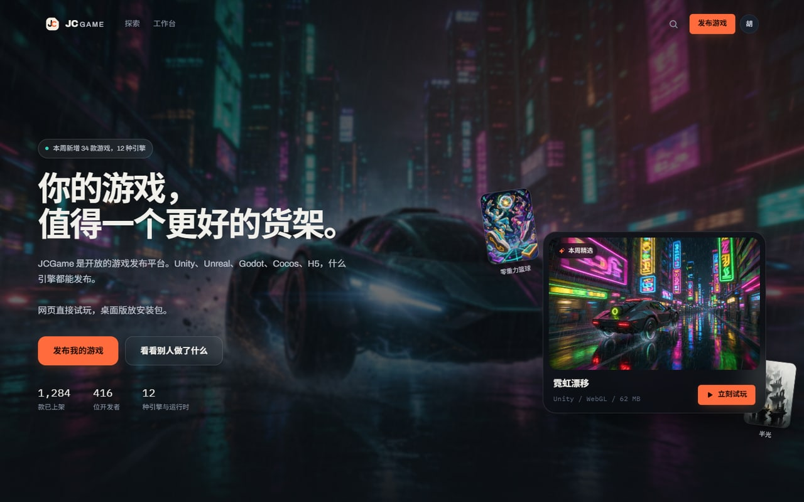

# JCGame

开放式独立游戏平台。任何引擎、任何平台都能发布；网页直接试玩，桌面版给安装包。

**线上地址**：https://jcgame.app.workbuddy.host/?sharecode=YHQCG3L3MY



## 启动

```bash
npm install
npm run dev      # http://127.0.0.1:5173
npm run build    # 产物在 dist/，同时复制一份到 site/（线上用）
npm start        # 生产静态服务器（读 PORT），带 SPA 回退
```

线上部署由 `server.mjs` 提供：读 `process.env.PORT`、绑定 `0.0.0.0`、
非静态资源路径回退到 `index.html`（这样 `/explore`、`/game/xxx` 可以直接打开）。
构建产物会被复制到 `site/` —— 发布沙箱不接收 `dist/` 这类构建目录，所以必须另存一份。

## 页面

| 路由 | 页面 | 说明 |
|---|---|---|
| `/` | 首页 | 满版图像 hero + 画中画精选面板 / 横向热玩 / 编辑精选 / 分类色块 / 最新上架 / 两种发布方式 / 纸色发布带 |
| `/explore` | 探索 | 粘性工具栏、分类彩色 chip、混合尺寸网格（前 2 张 16:10）、右侧筛选抽屉、条件写进 URL |
| `/game/:slug` | 详情 | 32px 圆角主视觉、运行入口（网页试玩沙箱浮层 / 客户端下载）、画面切换 + 灯箱、规格卡 |
| `/upload` | 发布 | 四步向导，按运行方式与引擎动态换表单，拖拽上传、校验、7 段完成度、发布成功态 |
| `/creator/:handle` | 开发者主页 | 横幅 + 压边头像、作品、关于 |
| `/me` | 工作台 | 我的游戏 / 草稿 / 收藏 / 点赞 / 资料 / 设置，含 7 天趋势图与最近动态 |

演示入口：`/game/neon-drift`（网页试玩）、`/game/ink-tide`（客户端下载）、`/game/tundra-courier`（无截图状态）。

## 结构

```
src/
  data/games.ts        # 模拟数据 + 类型 + 格式化（唯一的"后端"）
  hooks/useGameSearch.ts
  components/          # Logo / Header / Footer / GameCard(Post|Tile|Row) / PlayModal / SearchDialog / Toast / Reveal
  pages/               # Home / Explore / GameDetail / Upload / Creator / Dashboard / NotFound
  index.css            # 设计 token（@theme）+ 基础样式 + 组件类
DESIGN.md              # 设计规范 v2：品牌 / 色彩 / 圆角 / 画中画 / 动效 / 组件 / 页面结构
docs/SKILLS-RESEARCH.md # GitHub 设计 Skill 调研（两轮）
scripts/
  optimize-art.mjs     # 裁水印 + 缩放 + WebP
  shoot.mjs            # 全页截图（桌面 + 移动，含溢出检测、等待图片加载）
  interact.mjs         # 交互态截图（搜索 / 试玩 / 菜单 / 校验）
public/art/            # 封面 / 截图 / 主视觉
```

## 本轮改版做了什么

- **品牌**：PLAYGROUND → **JCGame**，新标记是「切角方块 + J + C」，
  切角与 C 的开口朝同一方向；旧 Logo 与旧配色全部弃用。
- **首屏**：从「左文右图」改为**满版图像压字 + 画中画**（模糊背景 → 精选面板 → 带标题的浮动小封面，
  鼠标视差 + 滚动视差）。
- **色彩**：珊瑚 `#FF6B3D` + 青绿 `#33D6C0` + 6 级表层 + 9 个分类内容色；反色带改纸色；
  每个区块容器有 6–10% 色温染色。
- **圆角**：2–4px 的近直角体系换成 6/10/14/20/26/36 六级，并规定「尺寸越大圆角越大」。
- **卡片**：图片背景卡 + 强化的信息底座（浅色封面上也读得清）+ 悬停上浮与信息渐显。
- **动效**：主操作反馈、tab/步骤滑块（`layoutId`）、区块进场、hero 视差、图表生长；
  全部读 `prefers-reduced-motion`。
- **图标**：Lucide → **Phosphor**（bold / duotone / fill 三档语义）。
- **评审**：按 oil-ui 流程派了无上下文的评审 Agent 看真实截图，首轮 5.5/10，
  修完它指出的 10 个问题（记录在 `DESIGN.md` §12），其中 4 个是真 bug。

## 现在能做什么 / 还没做什么

已实现：六个页面的视觉与路由、搜索与筛选、收藏与点赞、试玩浮层完整状态机（加载进度 → 运行 → 失败重试）、
上传向导的动态表单与校验、草稿与发布反馈、截图灯箱与切换、抽屉、滑块、视差、移动端菜单。

未实现：真实登录、真实文件上传与存储、试玩 iframe 接入、下载分发、支付、后台管理。
数据层已隔离，接口形状见 `DESIGN.md` §13。

## 素材

12 张封面 + 3 张截图 + 1 张主视觉为 AI 生成，经 `scripts/optimize-art.mjs` 处理（裁掉生成水印、缩放、WebP，
单张 70–230KB）。每个游戏一种画风，避免全站同一张占位图。开发者头像用「首字 + 辅助色」字母块，不伪造真人照片。
站内数据（上架数、粉丝数、试玩数）为演示数据。
